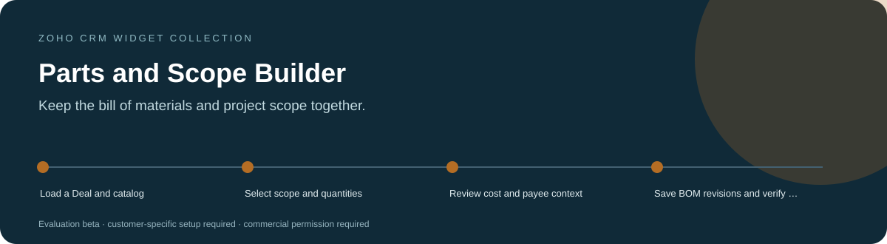
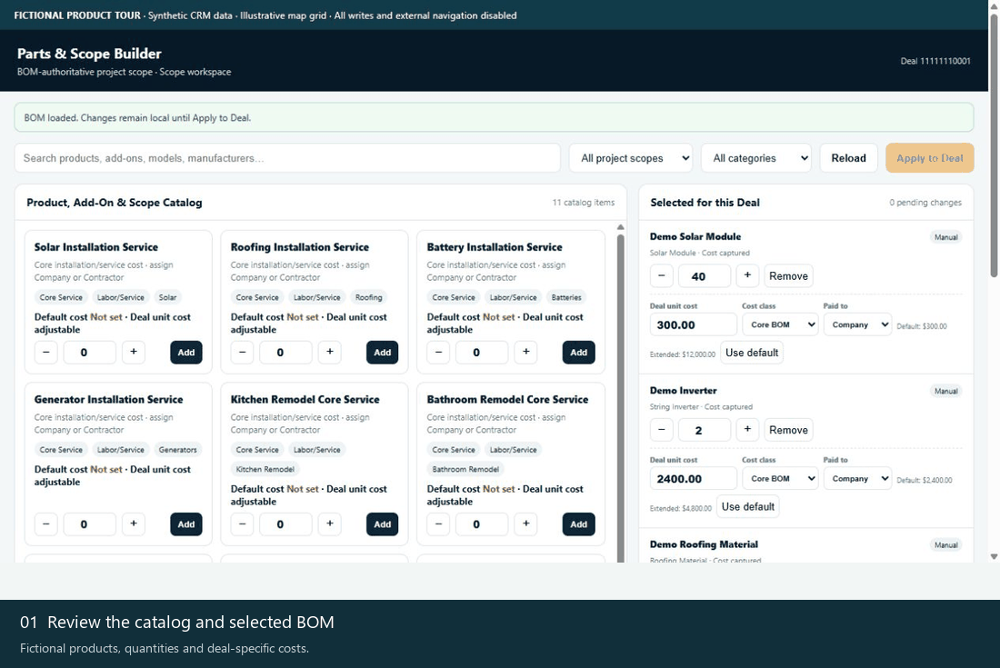
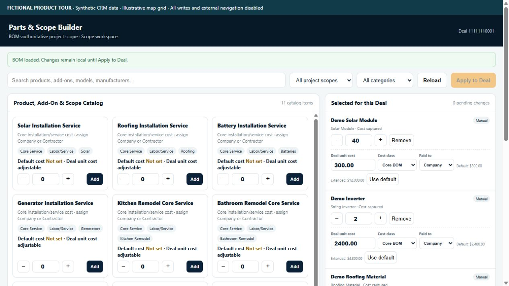
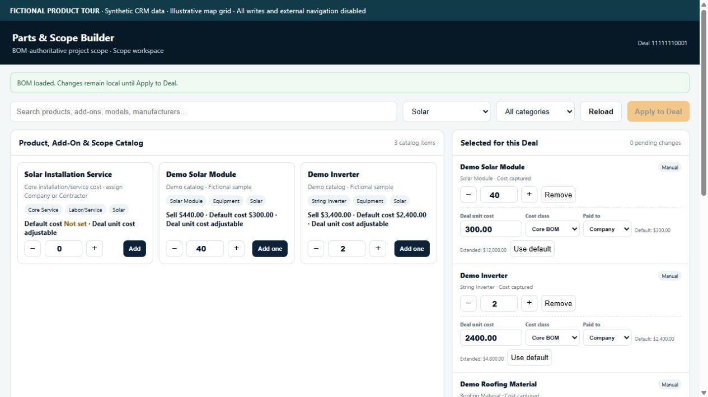
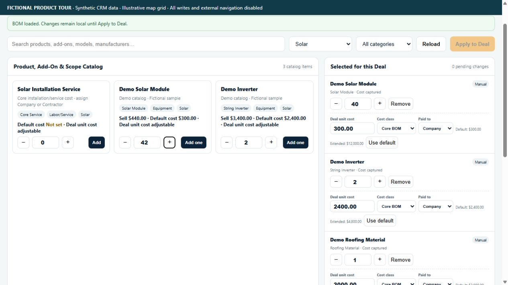
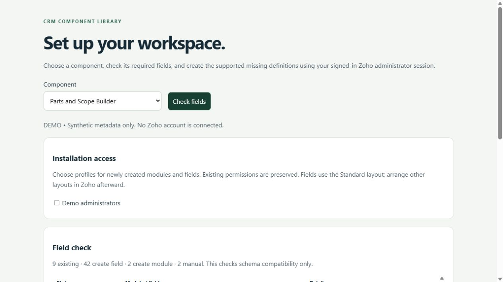

<h1 align="center">Parts and Scope Builder for Zoho CRM</h1>

<strong>Keep the bill of materials and project scope together.</strong> A Deal workspace for selecting products and service costs, managing manual bill-of-materials lines and reviewing the scope and project-cost context they produce.

Commercial product showcase · Licensing and installation by arrangement

> [!IMPORTANT]
> **Showcase only.** This public repository contains product information and fictional demonstration media. It provides no software source, installable packages, free beta downloads or software license. Commercial availability and deployment scope are agreed privately. Product validation and the limitations below still apply.

[Discuss a commercial installation](https://github.com/RawPowered/Zoho-Parts-and-Scope-Builder/issues/new?template=commercial-inquiry.yml) · [Deployment model](DEPLOYMENT.md) · [Commercial terms overview](COMMERCIAL.md)

## A focused workspace

Estimators, project coordinators and operations teams maintaining a Deal's bill of materials.

| Capability | What it helps with |
| --- | --- |
| **Catalog to scope** | Select products, service add-ons and core installation services with quantities. |
| **Deal-specific economics** | Review or set unit-cost snapshots, project-cost classes, payees and contractor assignments. |
| **Revision-aware edits** | Keep API-owned lines visible and locked while preserving removed/superseded manual-line history. |

## Product tour

These captures show the actual widget running against an isolated fictional-data adapter. No customer account, real person, customer branding or production credential is used. CRM writes and outbound navigation are blocked. Map backgrounds are illustrative grids; required third-party attribution is retained.

### Watch the workflow

The animation is a sequence of actual interface states, held for readability. It is not a recording of a live customer installation.

### Start with the workspace

Fictional products, quantities and deal-specific costs.

### Follow the next actions

<table><tr><td width="50%"><strong>Filter by project scope</strong>
Solar narrows the catalog while the selected Deal items remain visible.
</td><td width="50%"><strong>Adjust a local quantity</strong>
Change the sample quantity; no CRM writes are allowed in this preview.
</td></tr></table>

### Prepare the account deliberately

A separately licensed Schema Setup companion can be scoped to this product. It reads field metadata, identifies compatible existing definitions, and distinguishes missing definitions from manual steps. A field plan does not certify that functions, workflows or permissions are complete.

All records and sample labels are fictional. Preview tooling and installable software are not distributed through this public showcase. Commercial deployment still requires the documented account-specific acceptance checks.

## Commercial deployment

Licensed widget packages are supplied privately for the agreed customer organization. An authorized administrator installs them directly inside Zoho CRM using **Zoho internal hosting**, sets the supplied entry page and attaches the intended CRM placement. A Deal record button or related-list widget.

Schema, access profiles, workflows and service connections are reviewed for the licensed installation. A showcase screenshot does not certify compatibility or complete those steps. WordPress integration, where licensed, runs on the customer's live WordPress host and is configured separately. [How the platforms fit together](DEPLOYMENT.md).

## Data access and responsibilities

**Reads:** The active Deal, Products, available Services__s, Contractors and related Deal_BOM_Items.

**Writes:** User saves create/update Deal_BOM_Items with workflow triggers. Automation setup can create missing BOM workflow rules. Native Deluge workflows, rather than direct widget Deal updates, own the parent rollups.

**External services:** Zoho SDK/ZRC. No external product catalog or customer data is bundled.

## Current product boundaries

- Costs with missing snapshots remain unresolved; displayed totals must not be treated as final.
- The schema manifest covers static source references and does not install Services__s or seed a business catalog.
- API-owned lines and duplicate/manual mapping conflicts require deliberate review.

This is a commercial product under validation, not a free beta offer. Account-specific acceptance is required before production activation. Credentials and customer data are configured privately in the customer environment.

## Commercial availability

Request licensing, installation, account mapping or support through a [commercial inquiry](https://github.com/RawPowered/Zoho-Parts-and-Scope-Builder/issues/new?template=commercial-inquiry.yml). Include only a general use case; public issues must not contain customer records, account IDs, secrets or confidential details. Pricing, permitted organizations/users, delivery scope and support terms are agreed privately. This page does not collect payment or grant permission to use the software.

## Explore the collection

[Widget collection](https://github.com/RawPowered/Zoho-CRM-Widgets) · [Automation overview](https://github.com/RawPowered/Zoho-CRM-Automations) · [PowerPortals](https://github.com/RawPowered/PowerPortals-Showcase)

- [Service Map](https://github.com/RawPowered/Zoho-Service-Map)
- [Get Directions](https://github.com/RawPowered/Zoho-Get-Directions)
- [Service Map Dashboard](https://github.com/RawPowered/Zoho-Service-Map-Dashboard)
- [CEO Pipeline](https://github.com/RawPowered/Zoho-CEO-Pipeline)
- [Project Scoper](https://github.com/RawPowered/Zoho-Project-Scoper)
- [Project Task Builder](https://github.com/RawPowered/Zoho-Project-Task-Builder)
- [Financial Scope](https://github.com/RawPowered/Zoho-Financial-Scope)
